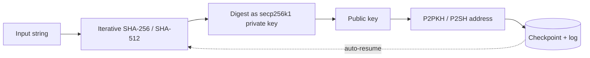

<div align="center">


<a href="https://github.com/Shubsaini08">
  
</a>

<br/>

[](https://t.me/Shainshub)
[](mailto:keyfoundhunt4ever@gmail.com)
[](https://x.com/Shubsaini08)
[](https://discord.gg/m4ryWABM)


</div>

---

## 👤 About

```python
class ShubSaini:
    role      = "Cryptography student & engineer"
    focus     = ["secp256k1 / ECDLP", "iterative hashing", "GPU acceleration", "blockchain tooling"]
    languages = ["C++", "Python", "C", "C#", "TypeScript", "Java"]
    approach  = "Fast, resumable, well-instrumented software"
    open_to   = ["research collaborations", "performance engineering", "consulting & training"]
```

I work on the practical side of elliptic-curve cryptography and high-throughput computation: taking an idea from a math paper to a measured, checkpointed, multi-threaded implementation. I care about correctness first, then throughput, then observability.

<table>
<tr>
<td width="50%" valign="top">

### 🔬 Research Focus
- ECDLP: Baby-Step Giant-Step, small-difference analysis
- Iterative SHA-256 / SHA-512 chaining
- Key-derivation and address-generation analysis
- Range-based search strategies

</td>
<td width="50%" valign="top">

### ⚙️ Engineering Focus
- Multi-threaded C++ with OpenSSL and libsecp256k1
- CUDA / OpenCL acceleration
- Async Python services and RPC clients
- Checkpointing, logging and auto-resume

</td>
</tr>
</table>

---

## 🚀 Featured Projects

<div align="center">

[](https://github.com/Shubsaini08/shathecurev2)
[](https://github.com/Shubsaini08/ETHPARSER)

[](https://github.com/Shubsaini08/KEYFOUND)
[](https://github.com/Shubsaini08/telecontrol)

[](https://github.com/Shubsaini08/Pubkey)

</div>

### 🔹 [shathecurev2](https://github.com/Shubsaini08/shathecurev2): CPU iterative hashing engine

A multi-threaded C++ engine that repeatedly applies SHA-256 (or SHA-512 → SHA-256) to input strings, treats each digest as a secp256k1 private key, and derives P2PKH / P2SH addresses.

- **~2.4M hashes/s** benchmarked on an Intel i9-13900K
- Full checkpointing, structured logging and automatic resume after interruption
- Entropy mutation for input variation
- Built on OpenSSL and libsecp256k1




### 🔹 [ETHPARSER](https://github.com/Shubsaini08/ETHPARSER): real-time Ethereum block scanner

An asynchronous bot that follows the chain head, extracts addresses from every new block, and reports balances, transaction counts and large holders.

- Async RPC polling with **fallback endpoints** and rate-limit handling
- Automatic flagging of addresses holding **more than 10 ETH**
- Telegram broadcast via aiogram


### 🔹 [KEYFOUND](https://github.com/Shubsaini08/KEYFOUND): Telegram crypto utility bot

A modular bot for everyday crypto tasks, with an async backend and command-based interface (`/bal`, `/derive`, `/list`).

- Live BTC balance checks and batch address processing
- Hash and public-key derivation
- Background news alerts, AI query mode and text-to-voice


### 🔹 [telecontrol](https://github.com/Shubsaini08/telecontrol): Telegram remote administration

Lets authorized administrators operate a machine from Telegram: shell commands, directory navigation, git clone, and file read/write.

- Strict **ID allow-listing** for access control
- Multi-device support with background keep-alive
- Python 3.8+, `subprocess` and `os`

> ⚠️ Intended only for machines you own, with the allow-list configured.

### 🔹 [Pubkey](https://github.com/Shubsaini08/Pubkey): Bitcoin public-key dataset

More than **100,000 Bitcoin public keys** extracted block by block from the blockchain, stored as plain-text files per block. It contains **no private keys** and is intended for researchers, forensic tooling and ECDLP studies. Continuously updated.

---

## 🧰 Tech Stack

<div align="center">

| | |
|:--|:--|
| **Languages** |       |
| **HPC & GPU** |     |
| **Cryptography** |     |
| **AI & Data** |   |
| **DevOps & Tools** |     |

</div>

---

## 🗺️ Roadmap

- [x] Multi-threaded CPU iterative hashing engine with checkpointing (`shathecurev2`)
- [x] Async Ethereum scanning and alerting (`ETHPARSER`)
- [x] Public Bitcoin public-key dataset (`Pubkey`)
- [ ] CUDA / OpenCL port of the hashing and key-derivation pipeline
- [ ] Baby-Step Giant-Step implementation with benchmarks
- [ ] Documentation, tests and reproducible benchmark suite for each repository

---

## 🤝 Work With Me

| Service | What you get |
|---|---|
| **Performance engineering** | Profiling, vectorization, threading and GPU offload for compute-heavy code |
| **Cryptographic tooling** | Custom utilities for key derivation, address generation and keyspace analysis |
| **Research prototypes** | Proof-of-concept implementations for ECC and hash-chain analysis |
| **Training & workshops** | ECC fundamentals, iterative hashing and GPU acceleration |
| **Authorized recovery** | Helping owners regain access to their *own* wallets from partial information |

Send a short spec or idea via [Telegram](https://t.me/Shainshub) or [email](mailto:keyfoundhunt4ever@gmail.com).

---

## 📊 GitHub Analytics

<div align="center">


</div>

---

## 🛡️ Responsible Use

My tools are published for research, education, and authorized recovery or testing of keys and systems that you own or have explicit permission to access. Do not use them against wallets, accounts or machines that are not yours.

---

## ☕ Support

If my work is useful to you, contributions are appreciated.

**BTC:** `bc1qwc24wqwu08x2cdnfzc40ezma4q5zsn37jxkkmt`

<div align="center">


</div>
